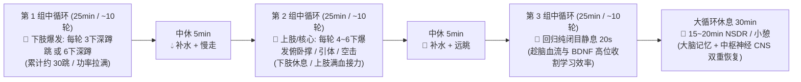

# 进阶玩法：意外发现的“文体两开花”体能×学习交叉协议

> **缘起：写完程序后的意外发现**
>
> 这个番茄钟原本纯粹是为了落实神经可塑性的“随机微休息”而写的（详见 [《神经可塑性超级协议与设计映射》](./neuroplasticity-protocol.md)）。但在程序完成后审视这套计时参数时，意外发现了一个极其巧妙的生理学巧合：
>
> 程序默认的 **`120s ± 30s`（即 `90 秒 ~ 150 秒`）随机专注间隔**，恰好精准落在了人体骨骼肌**磷酸原供能系统（ATP-CP / 磷酸肌酸）**的黄金恢复区间内！只需把微休息时长从 `10 秒` 调整到 **`20 ~ 25 秒`**，这个学习计时器瞬间就能化身为一台**兼顾无氧爆发力训练与兴趣学习的“文体两开花”交叉训练器**。

---

## 一、为什么这套计时器天然契合体能训练？

### 1. 完美匹配磷酸肌酸（ATP-CP）再合成动力学
在运动生物化学中，短促爆发力动作（如深蹲跳、爆发俯卧撑）主要依赖肌肉内储存的 ATP 与磷酸肌酸（CP）供能，基本不产生大量乳酸堆积。
- 磷酸肌酸消耗后的再合成**半衰期约为 `30 秒`**（30 秒恢复 50%，60 秒恢复 75%，90 秒恢复 **87.5%**；即便按偏保守的 45 秒半衰期估算，90 秒也已恢复 **75%** 以上）。
- 在这套番茄钟里，**坐着学习的 `90 ~ 150 秒` 正好充当了肌肉满血回蓝的组间间歇**；而随后的 **`20 ~ 25 秒` 微休息则是消耗磷酸原做功的爆发窗口**。

### 2. 随机间隔带来的两大竞技体能加成
相比传统的固定每分钟定时组（EMOM），本程序的随机偏移机制给运动员带来了两项贴近实战的额外收益：
1. **随机间歇反应式神经沟槽训练（Variable-Interval GTG）**：结合力量训练中的“神经沟槽训练法（Grease the Groove，远低于力竭阈值的亚最大高频神经募集）”，非固定时刻响起的提示音打破了机械预判，模拟竞技赛场上随时响应信号爆发输出的真实节奏（Repeat Power Ability）。
2. **自主神经“快挂快降”能力（心率恢复率 HRR 训练）**：从“起身爆发跳跃”到“迅速压低心率坐回进入阅读/思考”，本质上是在高频训练**交感神经（战斗兴奋）↔ 副交感神经（冷静专注）的快速切换速率**——非常类似冬季两项（Biathlon）中“高心率滑雪冲刺 → 瞬间屏息瞄准射击”，或球类/格斗项目在回合死球间隙迅速冷静阅读战术的能力。

---

## 二、模式定位：你适合哪种用法？

两种玩法服务于不同的核心优先级，可按当日状态自由切换：

| 维度 | 纯深度学习模式（默认） | 文体两开花模式（本协议） |
| :--- | :--- | :--- |
| **核心本位** | **硬核学习优先**（攻克新知、高密度记忆、复杂推导） | **运动员 / 体能优先，学习为日常兴趣爱好** |
| **小循环休息配置** | `10 秒` | **`20 秒` 或 `25 秒`** |
| **微休息行为** | 坐姿闭目放空，零动作输入（触发海马体 10 倍速重放） | **前 10s 无氧爆发动作 + 后 10~15s 呼吸降心率** |
| **中循环休息（5min）** | 起身活动或穿插 2 组“运动零食”唤醒警觉 | **纯慢走、补水/电解质、远眺放松眼肌** |
| **大循环休息（30min）** | 15~20min NSDR / 浅睡（记忆突触固化） | 15~20min NSDR / 浅睡（**记忆固化 + CNS 中枢疲劳双恢复**） |

---

## 三、推荐参数配置 (`config.json`)

只需将默认配置中的 `"小循环休息时间秒"` 修改为 **`20`**（或 **`25`**），重启程序即可生效：

```json
{
    "小循环基础时间秒": 120,
    "小循环随机偏移秒": 30,
    "小循环休息时间秒": 20,
    "中循环总时间分": 25,
    "中循环休息时间分": 5,
    "中循环组数": 3,
    "大循环休息时间分": 30,
    "监听地址": "127.0.0.1",
    "端口": 8080
}
```

---

## 四、单次 20~25 秒微休息拆解：前练爆发，后压心率

当 **🟨 琥珀黄进度条** 亮起、提示音响起时，将这 20~25 秒严格一分为二执行：

### 1. 前 8~10 秒：磷酸原纯爆发输出
- 听到提示音**立即起身**，高质量完成 **3 下全力深蹲跳**，或 **4~8 下快速自重深蹲**（也可替换为同等级上肢爆发动作）。
- **铁律**：严格将次数控制在**无明显乳酸灼烧感**的亚最大区间，追求每一动的动作速率与神经募集功率，绝不做到力竭变形。

### 2. 后 10~15 秒：生理性叹息（Physiological Sigh）闭目归位
- 动作完成的瞬间**立刻坐回椅上，闭上眼睛**，执行 **1~2 次“生理性叹息”**：
  1. 用鼻子深吸一口气，在肺部快满时**再快速短促地补吸第二口气**（彻底撑开塌陷的肺泡，最大化二氧化碳排出面积）；
  2. 通过嘴巴缓慢、细长地将气完全呼空。
- **科学作用**：这是实证最快的自主神经降速开关，能在 10 秒内强力激活迷走神经、迅速拉低心率，同时留出几秒闭目静息缓冲；待微休息结束提示音响起，睁眼即可平稳接续刚才的阅读或代码思路。

---

## 五、总训练容量精算与三组分化编排（防过载指南）

运动员最看重训练容量（Volume）管理。以中循环 `25 分钟`、`120s ± 30s` 专注 + `20s` 休息精算：
- 每个小周期平均约 `140 秒`，单组 25 分钟中循环会触发约 **9 ~ 10 轮** 微休息。
- 若每轮做 3 下深蹲跳（或 6 下深蹲）：
  - **1 组中循环（25 分钟）** ≈ **27~30 次全力深蹲跳**（或 **54~60 次深蹲**）。
  - **3 组大循环（约 85 分钟）** ≈ **80~90 次全力深蹲跳**（或 **160~180 次深蹲**）！

根据体能训练学准则（如 NSCA 增强式训练指南），单次训练课高强度下肢增强式跳跃（Plyometrics）的理想触地总次数约为 **60~100 次**。也就是说，若三组全跳深蹲跳，下肢冲击容量已接近单课上限。

因此，最科学、最护关节且最保学习质量的编排是**“按中循环分化轮换”**：



### 全流程节奏总结
1. **第 1 组中循环（下肢主导）**：高质量拿下约 30 次深蹲跳（或跳跃与快速深蹲交替），激活全身循环与肾上腺素。
2. **第 2 组中循环（上肢/核心主导）**：切换为爆发俯卧撑、门框引体向上或拳击空击组合，让下肢肌群与膝踝关节彻底休息，上肢磷酸肌酸满血输出。
3. **第 3 组中循环（沉浸学习收尾）**：前 50 分钟已不知不觉高质量完成了“~30 次爆发跳 + ~50 次上肢推拉”的扎实训练量；最后一组顺势切换回 **20 秒纯坐姿闭目放空**，趁运动诱导的脑血流量与 **BDNF（脑源性神经营养因子）** 处于峰值窗口，沉浸式享受高效学习。
4. **30 分钟大循环长休息（双重超量恢复）**：平躺或靠坐进行 15~20 分钟 **NSDR / Yoga Nidra 或浅睡**——既帮海马体固化刚才学的知识，又降低皮质醇、加速中枢神经系统（CNS）与神经肌肉接头的疲劳消除，真正实现“文体两开花”。
