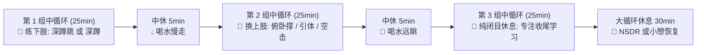

# 进阶玩法：意外发现的“文体两开花”体能×学习交叉协议

> **缘起：写完程序后的意外发现**
>
> 这个番茄钟原本纯粹是为了落实神经可塑性的“随机微休息”而写的（详见 [《神经可塑性超级协议与设计映射》](./neuroplasticity-protocol.md)）。但在程序完成后意外发现了一个极其巧妙的巧合：
>
> 程序默认的 **`120s ± 30s`（即 `90 秒 ~ 150 秒`）随机专注间隔**，恰好落在了肌肉**磷酸原供能系统（ATP/磷酸肌酸）**恢复 75%~87.5%+ 的黄金区间内！只需把微休息时长从默认的 `10 秒` 调到 **`20 ~ 35 秒`** 左右，这个学习计时器瞬间就能当成一台**兼顾爆发力训练与兴趣学习的“文体两开花”交叉计时器**来用。

---

## 一、为什么这套计时器天然适合“边学边练”？

1. **刚好契合 ATP/磷酸肌酸的恢复窗口**
   短促爆发力动作主要消耗肌肉内的 ATP 与磷酸肌酸（CP），基本不产生大量乳酸堆积。磷酸肌酸再合成的半衰期大约在 `30 秒` 左右——也就是说，哪怕随机抽到最短的 `90 秒` 专注时间，肌肉能量也已经恢复了大半，完全够起身再做几下高质量的爆发动作。**坐着学习的时间正好用来回蓝，短暂的微休息正好用来训练。**
2. **随机间隔比死板定时更有训练乐趣**
   相比每分钟固定响一次的传统计时器（EMOM），`90 ~ 150 秒` 的随机提示音结合了“神经沟槽训练法（Grease the Groove，不做力竭、只做高质量神经募集）”，还能顺带锻炼**从爆发动作迅速冷静下来投入阅读/思考的心率恢复与状态切换能力**。

---

## 二、模式定位对比

两种用法按个人主次需求随时切换即可：

| 维度 | 纯深度学习模式（默认） | 文体两开花模式（本玩法） |
| :--- | :--- | :--- |
| **适合场景** | **硬核学习优先**（啃难点、高密度记忆） | **运动员 / 体能优先，学习偏向日常兴趣** |
| **小循环休息设置** | `10 秒` | **`20 ~ 35 秒`**（按个人节奏微调） |
| **微休息做什么** | 坐着闭目放空，不动脑也不动身体 | **起身从容做几下爆发动作 + 坐回深呼吸压心率** |
| **中循环休息（5min）** | 起身活动或穿插少量运动提神 | **喝水、慢走、远眺放松眼睛** |
| **大循环休息（30min）** | NSDR / 小憩（巩固记忆） | NSDR / 小憩（**巩固记忆 + 恢复中枢神经疲劳**） |

---

## 三、配置与实操参考示例

### 1. 修改 `config.json`
只需根据你喜欢的节奏，把 `"小循环休息时间秒"` 调到 **`20` ~ `35`** 之间（重启生效）：

```json
{
    "小循环基础时间秒": 120,
    "小循环随机偏移秒": 30,
    "小循环休息时间秒": 20,
    "中循环总时间分": 25,
    "中循环休息时间分": 5,
    "中循环组数": 3,
    "大循环休息时间分": 30,
    "监听地址": "127.0.0.1",
    "端口": 8080
}
```

### 2. 微休息怎么安排？（不赶时间，重质不重量）

当 **🟨 琥珀黄进度条** 亮起时，核心节奏就两步：**从容做动作 → 坐回压心率**。动作一定不要为了凑数而图快变形（深蹲跳做好落地缓冲，普通深蹲保持节奏控制）：

* **紧凑示例（如微休息设 `20 秒`）**：起身稳稳做 **1 下全力深蹲跳**（或 **2~3 下深蹲**），做完立刻坐回椅子闭眼做 1 次深呼吸，提示音结束刚好睁眼继续看书/写代码。
* **充裕示例（如微休息设 `30 秒`）**：起身从容做 **2 下全力深蹲跳**（或 **4~5 下深蹲**），坐回闭眼做 1~2 次深呼吸让心率彻底平复。

> **快速降心率小技巧（生理性叹息）**：坐回椅子闭眼时，可以用鼻子连吸两口气（第一口深吸，快满时再短促补吸一口把肺泡撑开），然后用嘴巴缓慢长呼出去——实测只需一两次就能把刚跳完的心率迅速压稳。

---

## 四、大循环三组轮换建议（护关节、防疲劳）

一个完整大循环包含 **3 组 25 分钟的中循环**。由于每组里大约会触发十来次微休息，积少成多下来的总训练量其实相当可观，建议按组换部位轮流练：



* **第 1 组中循环**：练下肢（深蹲跳 / 深蹲），把身体循环和精神彻底激活。
* **第 2 组中循环**：换上肢或核心（比如做几下俯卧撑、门框引体向上或空击），让双腿和膝踝休息，上肢满血接力。
* **第 3 组中循环**：前两组已经顺带完成了很扎实的体能训练量，最后一组可以直接切回**坐姿闭目放空**，趁运动后大脑供血和神经营养因子（BDNF）充足的状态，专心享受学习。
* **30 分钟大循环长休息**：躺下或靠坐做 15~20 分钟 **NSDR 或闭目小憩**，让大脑记忆和中枢神经疲劳一起满血恢复。
