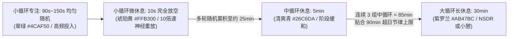

# 设计灵感与科学依据：神经可塑性超级协议

> **来源致谢与版权说明**
>
> 本项目的核心计时机制灵感源自斯坦福大学神经生物学教授 Andrew Huberman 博士在 Huberman Lab 官方通讯中发布的公开文章：
> - **原文标题**：[Teach & Learn Better With a “Neuroplasticity Super Protocol”](https://www.hubermanlab.com/newsletter/teach-and-learn-better-with-a-neuroplasticity-super-protocol)
> - **发布日期**：2021 年 10 月 29 日（Huberman Lab — Neural Network Newsletter）
>
> **声明**：本文档为面向本项目使用者与开发者的**中文核心科学原理提炼与软件工程映射说明**，采用原创结构化总结撰写，并非原文的逐字翻译或官方译本。原文著作权归 Huberman Lab / Scicomm Media 所有，强烈推荐有兴趣的读者点击上方链接阅读英文原版。

---

## 一、核心科学认知：触发（Trigger）与重塑（Rewiring）

在神经科学视角下，高效学习与技能习得（即**神经可塑性 Neuroplasticity**）并非单一过程，而是由两个截然不同的生理阶段闭环组成：

1. **清醒专注期 = 触发信号（Trigger）**：高警觉度（肾上腺素参与）与高度集中的注意力（乙酰胆碱参与）在目标突触上打下“需要被强化”的化学标记。
2. **休息与睡眠期 = 物理重塑（Rewiring）**：大脑神经回路真正的结构性连接重塑，实际上发生在学习间隙的**随机 10 秒微休息**、学习后的 **NSDR（非睡眠深度休息）** 以及当晚的**深度睡眠**中。

传统固定时长的倒计时工具往往只关注宏观工作块，忽略了学习过程中高频微休息带来的神经重放效应，也容易因固定刻板的节奏使大脑产生适应性疲劳。本项目正是为了将这套行为学协议转化为零干扰的自动化节奏器而设计。

---

## 二、“神经可塑性超级协议”九步要点提炼

Andrew Huberman 在原文中归纳了 9 项基于实证研究的行为学工具（其中**第 1、2、9 项为不可妥协的底层基石**，其余各项可根据场景灵活组合）：

### 1. 提升警觉度（Get Alert）
启动神经可塑性的前提是大脑与身体处于清醒警觉状态（主要由肾上腺素释放驱动）。除了合理安排早间咖啡因摄入外，还可以在学习开始前采用简单的呼吸激活法：快速进行 25~30 次深呼吸（鼻吸口呼），随后呼空肺部气体并自然屏息 15~60 秒，接着深吸一口气短暂屏息，一旦产生呼吸冲动便立即恢复正常呼吸（切勿强行憋气）。

### 2. 视觉锚定聚焦（Get Focused）
**心理专注追随视觉专注（Mental focus follows visual focus）。** 在正式切入任务前，先凝视屏幕、墙面或桌面上的某一个固定点 30~60 秒（期间可正常眨眼）。这种略带努力感的凝视能主动调动大脑“自上而下”的注意力控制网络，促进前脑乙酰胆碱释放。切入工作初期若感觉注意力偶有闪烁游离属于正常生理现象；同时应将手机移出视线并关闭无关网页。

### 3. 高频重复练习（Generate Repetitions）
在保证安全的前提下，在单次学习周期内尽可能多地完成有效重复（无论是乐器音阶练习，还是解题、阅读与编码推进）。有意识地以**略快于本能舒适区的速度**执行重复，有助于抑制走神并自然维持警觉水平。

### 4. 预期并拥抱错误（Expect & Embrace Errors）
犯错时产生的紧迫感或轻微挫败感并非负面阻碍，而是大脑调高警觉与注意力的正向激活信号（计算建模研究显示约 **15% 的错误率**往往对应较理想的任务挑战度）。出错后不要停滞沮丧，应趁前脑处于高注意力窗口期，立即发起下一次尝试。

### 5. 随机插入微休息（Insert Micro-Rest Intervals at Random）
人类神经影像研究发现了一种反直觉的高效机制——**间隙效应（Gap Effects）**：在学习过程中每隔一段时间停下 **10 秒钟**且什么都不做，海马体与大脑皮层会以 **10 倍速**自发重放刚才练习时的神经活动模式（相当于在清醒状态下提前获得类似深度睡眠的高倍速神经重复）。
- **推荐频率**：平均每学习 **2 分钟**插入 1 次 **10 秒**停顿。
- **关键前提**：必须**随机分布**，切忌卡在整点固定每 2 分钟机械触发。

### 6. 随机间歇性奖励（Use Random Intermittent Reward）
控制动机与渴望的神经回路受多巴胺奖励机制调节。固定、完全可预期的奖励会迅速丧失激励效力；无论是自我奖励还是教学反馈，保持**随机与间歇性**才能长期维持高昂的内在驱动力。

### 7. 单次高强度学习不超过 90 分钟（Limit Sessions to 90 Minutes）
人体受超日节律（Ultradian Cycle）支配，单次维持高强度专注与认知努力的生理极限约为 **90 分钟**（更短亦可）。满约 90 分钟后必须进行充分休息；若一天安排多轮高强度深度工作，两轮之间建议间隔 2~3 小时以上，多数人每日高强度学习的总上限约为 270 分钟。

### 8. 学习后执行非睡眠深度休息（NSDR Protocol）
多项人类实验表明，在完成一轮高强度学习后的 1 小时内，进行一段 10~30 分钟的 **NSDR（Non-Sleep Deep Rest，非睡眠深度休息）**——例如听一段 Yoga Nidra 身体扫描引导音频、自我催眠放松或进行 20 分钟浅睡小憩——能够显著加快记忆巩固速率并加深学习深度。

### 9. 保障当晚及后续高质量深度睡眠（Quality Deep Sleep）
清醒时的刻苦练习只是提供了可塑性的“可能性刺激”，神经突触真正的物理重连发生在当晚乃至随后数晚的深度睡眠中。长期目标应是让至少 80% 的夜晚都获得充足且高质量的睡眠。

---

## 三、科学原理与本程序设计的精确映射

本项目通过三级嵌套循环引擎（`timer.go`）与默认参数配置（`config.json`），将上述协议中最核心的时间节律自动化落地：

| 协议核心要求 | 本程序对应设计 / 默认配置 (`config.json`) | 工程实现与体验价值 |
| :--- | :--- | :--- |
| **平均每 2 分钟随机触发停顿** *(第 5 步：不可整点固定触发)* | `"小循环基础时间秒": 120` `"小循环随机偏移秒": 30` | 单次微专注时长在 `90 秒 ~ 150 秒` 区间按整秒均匀随机采样，数学期望恰好为 2 分钟，且每次触发时机不可预测，防止大脑产生节律麻木。 |
| **10 秒间隙效应（Gap Effects）** *(第 5 步：10 倍速神经重放)* | `"小循环休息时间秒": 10` *(琥珀黄 `#FFB300` 阶段)* | 到点播放轻提示音并切换为 10 秒琥珀黄进度条，提示使用者短暂松开键盘/笔杆放空大脑，完成后无缝切回专注。 |
| **单轮总时长不超 90 分钟** *(第 7 步：超日节律生理边界)* | `"中循环总时间分": 25` `"中循环休息时间分": 5` `"中循环组数": 3` | 兼顾经典番茄钟的阶段感：3 组约 25 分钟的中循环加上组间 2 次 5 分钟缓冲，整个大循环累计约 **85 分钟**，精准卡在 90 分钟疲劳阈值之内。 |
| **学后 10~30 分钟 NSDR 巩固** *(第 8 步：非睡眠深度休息)* | `"大循环休息时间分": 30` *(紫罗兰 `#AB47BC` 阶段)* | 完成全部 3 组中循环后自动进入 30 分钟紫罗兰长休息倒计时，直接作为执行 NSDR 音频放松或 20 分钟闭目小憩的专属计时器。 |
| **视觉锚定与低干扰环境** *(第 2 步：减少分心与认知负荷)* | **极简无文字阶段配色** + **无暂停自律机制** | 界面剥离一切解释性文字，仅凭色彩直觉感知阶段，避免阅读文字抢占工作记忆；不设“暂停”，一旦外力打断专注场，一键从 `0` 重启新一轮聚焦。 |

---

## 四、配合本番茄钟的实战使用指南

为了让软件计时器发挥最大的神经可塑性增益，建议按以下方式配合使用：

1. **启动前（约 1 分钟）**：清走桌面干扰与手机，凝视屏幕上即将开始计时的区域或固定锚点 30~60 秒完成视觉聚焦，然后启动番茄钟（或按 `R` 从 `0` 开始）。
2. **🟩 翠绿进度条（90~150 秒随机微专注）**：全神贯注推进手头任务，允许并接纳执行中的小错误，遇到卡点立即重试。
3. **🟨 琥珀黄进度条（10 秒微休息 —— 最关键细节）**：听到小循环提示音后，**立刻停下手头动作，闭眼或目光柔和放空 10 秒**。**绝对不要**在这 10 秒内看手机、切聊天窗口或阅读新信息——只有真正的空白停顿才能让海马体完成 10 倍速神经重放。
4. **🟦 清爽青进度条（5 分钟中循环休息）**：起身活动肢体、喝水、远眺放松眼部肌肉（解除近距离视觉聚焦），准备迎接下一组 25 分钟中循环。
5. **🟪 紫罗兰进度条（30 分钟大循环长休息）**：你已完成约 85 分钟的高强度深度学练！强烈建议趁此 30 分钟平躺或靠坐，进行 10~20 分钟的 **NSDR / Yoga Nidra** 练习或浅睡小憩，让大脑将刚才打下的突触标记固化为长期能力。
